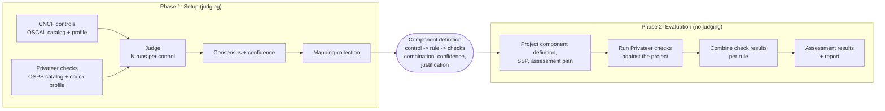
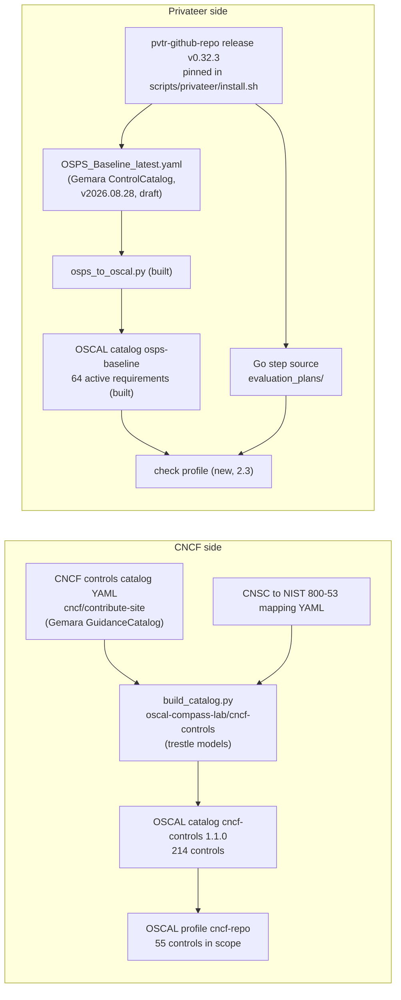
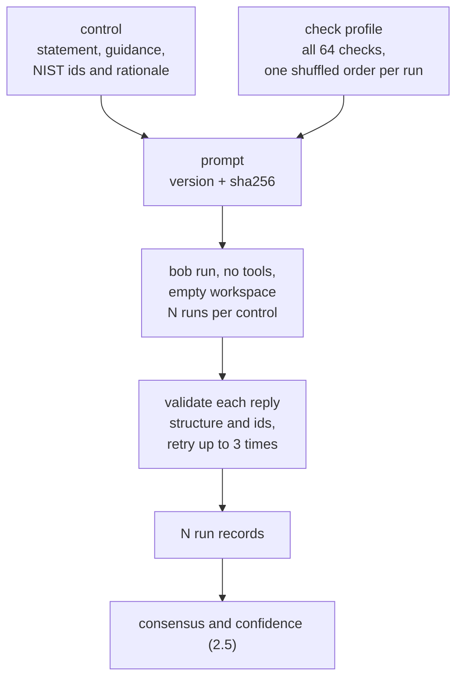
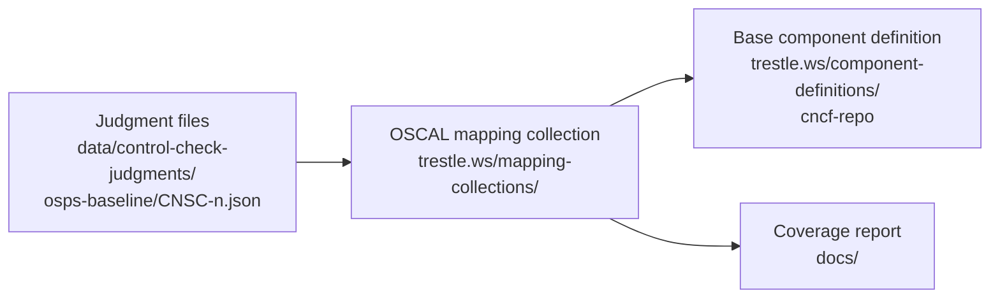
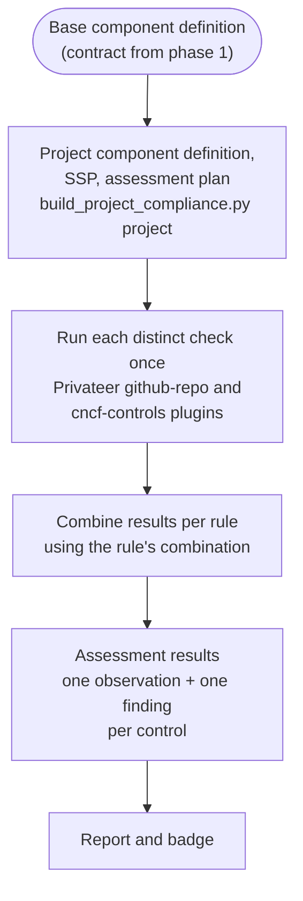

# Control to check mapping: design

Status: draft for discussion. Nothing here is implemented except where marked "built".

## 1. Two phases

The work is two separate phases with one contract between them.

| | Phase 1: Setup | Phase 2: Evaluation |
|---|---|---|
| Question | Which checks establish each control, and how sure are we? | Does this project pass those checks? |
| Runs | Once per change to the catalogs or the plugin | Once per project, every assessment |
| Uses a language model | Yes | No |
| Input | CNCF controls, Privateer checks | The component definition, the project |
| Output | OSCAL documents, led by the component definition | Assessment results and a report |
| Reads the other phase's data | No | Only the component definition |



**The contract is the component definition.** Phase 2 never reads judgments, run records or the
mapping collection. If something is needed in phase 2, it is put in the component definition by phase 1.
This keeps assessment fast, repeatable and free of a model.

### Non-goals

- Judging whether a project is compliant. That is phase 2, and it is not a judgment: it is the
  result of running checks.
- Controls outside the `cncf-repo` profile (55 of 214).
- Changing how Privateer runs its checks.

## 2. Phase 1: Setup

### 2.1 The question

For control C and all available checks: which checks, if they all pass, would show that C is satisfied?
This is sufficiency. It is not "which checks are on the same topic". A related check that does not
establish part of the control must not be selected.

An answer has these parts:

| Part | Values | Meaning |
|---|---|---|
| checks | 0 to 4 check ids | The selected checks |
| combination | single, all-of, any-of, none | How they combine |
| sufficiency | full, partial, none | Whether they establish all, some or none of the control |
| covered | text | What the checks establish |
| not_covered | text | What stays unproven |
| conditions | text | Conditions under which the checks apply |
| stated_confidence | 0 to 1 | The judge's stated certainty |
| stated_coverage | 0 to 1 | The share of the control the judge says the checks establish |
| rationale | text | Why these checks, and why not the near misses |

### 2.2 Inputs



| Input | Source | Status |
|---|---|---|
| CNCF controls catalog | Copy of `oscal-compass-lab/cncf-controls`, byte-identical to its HEAD on 2026-11-05. That repo builds it from the CNCF TAG Security and Compliance YAML with `build_catalog.py` and trestle's Python models. | Exists |
| In-scope profile | `trestle.ws/profiles/cncf-repo/profile.json` | Exists |
| OSPS requirements | Privateer plugin v0.32.3 catalog, converted by [`scripts/osps_to_oscal.py`](../scripts/osps_to_oscal.py) | Built |
| Check profile | How each requirement is implemented | New |
| NIST anchors | Shared 800-53 ids, already linked in the CNCF catalog | Optional, decision D5 |

No mapping from CNCF controls to OSPS requirements exists upstream. The OSPS 2025_10 and 2026_02
catalogs map OSPS to other frameworks (NIST 800-161, CSF, SSDF and others) but not to CNSC. The pinned
catalog has no mappings at all. The only indirect link is through 800-53 ids: it reaches 19 of the 55
controls, at the grain of a whole OSPS control. It is evidence, not an answer.

### 2.3 Check profile

The judge sees more about a check than its requirement text. For each active OSPS requirement:

| Field | Source | Example |
|---|---|---|
| id, title, statement, recommendation, applicability | OSPS catalog | OSPS-AC-03.01 |
| steps | Plugin registry `evaluation_plans/evaluation-plans.go` | `access_control.BranchProtectionRestrictsPushes` |
| evidence | Derived from what the step reads | `github-api`, `security-insights`, `both`, `ai`, `built-in`, `gate-only` |
| gates | Leading steps such as `IsCodeRepo`, `IsActive`, release checks | OSPS-GV-03.02 applies to code repos only |
| plugin version, source hash | Pin and hash | v0.32.3 |

Evidence matters because a pass differs in strength:

- `built-in`: GitHub guarantees it for every project. Five requirements.
- `github-api`: a setting or fact was observed.
- `security-insights`: the project declared it in a file. The scanner did not observe it.
- `ai`: a model reviewed it. Three requirements.
- `gate-only`: every step is a precondition, so a pass shows only that the repository has code or is
  active.

Not recorded: which results a step can return. A first attempt scanned each function's text and was
wrong for at least two steps, because results come back through helper functions. A reliable answer
needs a Go parse. Observed results from real runs are a better source and are out of scope.

The rules that assign each evidence label are written down in one place so a wrong label is corrected
once.

### 2.4 Judge



The prompt is the one already written in `judge_controls.py`: the control, the checks, the question, and
rules that demand sufficiency over topic, strictness on quantity and conditions, and a stated
not-covered part. Changes:

- Each check line adds the evidence kind and gates.
- The reply adds `stated_confidence` and `stated_coverage`.
- The prompt version and prompt hash are recorded with each run.

Runs:

- N independent runs per control, each a separate `bob run` with no tools, no repository access and an
  empty temporary workspace.
- The check list is shuffled in each run, seeded from the control id and run index, so a rerun builds the
  same prompt. This tests whether the answer depends on list order.
- Authentication is `BOB_API_KEY` in the environment. It is never printed, logged or written to a file.

How this differs from the `compliance-mapping` skill (read in full: SKILL.md, `build_judge_prompt.py`,
`score_calibrate.py`, `emit_oscal.py`):

| Aspect | `compliance-mapping` | This design |
|---|---|---|
| Question | Do the two controls overlap? | Do the selected checks together establish the control? |
| Candidates | Embedding blocking, top 20 | Not needed: 64 checks fit in one prompt |
| Confidence | Model's number against a fixed threshold | Model's number combined with measured agreement across runs |
| Several links to one target | Averaged | Kept as a set with a stated combination |
| Output | Relationship, confidence, coverage, one-sentence rationale | Same, plus combination, sufficiency, not-covered, conditions |
| Humans | None in the pipeline | None in the pipeline |

### 2.5 Consensus and confidence

Confidence here is **stability**: how consistently the judge gives the same answer when the order of
the evidence changes. It does not show that the answer is correct, and nothing in the pipeline can. The
output says so.

For each control with N run records:

1. **Consensus set.** The most frequent set of selected checks, ignoring order. Ties go to the smaller
   set. If no set reaches the majority share (section 2.9), the control is `undetermined`.
2. **Agreement** `a`: the fraction of runs whose check set and sufficiency equal the consensus.
3. **Stated confidence** `s`: the median `stated_confidence` of the agreeing runs.
4. **Confidence** = min(a, s). A control is only as certain as its weakest signal.
5. **Coverage** = the median `stated_coverage` of the agreeing runs.
6. **Text.** `covered`, `not_covered`, `conditions` and `rationale` come from the agreeing run with the
   lowest index. That index is recorded.

| Mapping status | Rule |
|---|---|
| `established` | sufficiency `full` and confidence at least T_high |
| `partial` | sufficiency `partial`, or `full` with confidence between T_low and T_high |
| `no-check` | sufficiency `none` with confidence at least T_low |
| `undetermined` | confidence below T_low, or no consensus |

The status describes the mapping: what the checks would establish if they pass. It says nothing about
any project. Thresholds live in the spec (section 2.9). Starting values are T_high 0.75 and T_low 0.5.
They are untuned placeholders.

### 2.6 Outputs of phase 1



**Judgment file, one per control.** Holds the consensus, every run, the metrics and the provenance:

- `consensus`: checks, combination, sufficiency, covered, not_covered, conditions, rationale, and the
  index of the run the text came from.
- `metrics`: N, agreement, median stated confidence, confidence, coverage, mapping status.
- `runs[]`: each run's verdict, shuffle seed, attempts, cost and raw reply.
- `provenance`: prompt version and hash, check-profile hash, OSPS source hash, CNCF catalog version,
  Bob version, time.

There is no review block. If a person's override is ever wanted, it would be a separate file that wins
over the consensus, so the machine output is never edited.

**OSCAL mapping collection.** One `map` per control with at least one check. Direction follows the
`compliance-mapping` convention, "source implements target": sources are OSPS requirements, targets are
CNSC controls.

| OSCAL field | Value |
|---|---|
| `sources` | The consensus checks |
| `targets` | The control |
| `relationship` | Decision D3 |
| `confidence-score.percentage` | Confidence |
| `coverage.target-coverage` | Coverage |
| `matching-rationale` | Rationale |
| `qualifiers` | Combination, sufficiency, conditions, not-covered |
| `props` | Mapping status, agreement, N, stated confidence, prompt hash, source hashes, judged-by |
| `target-gap-summary` | Controls with status `no-check` or `undetermined` |

Trestle's `Map` model has `qualifiers` (subject, predicate, category, description), `props`,
`confidence-score` (a category or a percentage), `coverage` and `matching-rationale`, so each field has a
place. Whether trestle validation accepts the exact values has **not been tested**. That is the first
check when implementing.

**Base component definition.** This is the contract. It replaces the hand-written `MAPPED` and
`UNMAPPED` tables in [`scripts/privateer_mapping.py`](../scripts/privateer_mapping.py) as the source of
which checks relate to which control. For each in-scope control:

- a rule on the "CNCF Source Repository" component, as today;
- a check on the validation component for each consensus check, as today, in `check_set_NN` groups;
- new properties on the rule: combination, sufficiency, mapping status, confidence, coverage;
- the justification (covered, not covered, conditions, rationale) in the rule's remarks. Today the
  hand-written `_note` is dropped at `build_project_compliance.py:69`, so the reasoning never reaches
  the OSCAL output.

Whether the existing builder can write several checks per rule with a combination property is **not yet
verified**. The JSON already repeats `check_set_NN` groups, so the structure is plain OSCAL.

### 2.7 Reproducibility

- Every input is hashed or pinned: prompt, check profile, OSPS source, CNCF catalog version, plugin
  version, Bob version.
- A control is rejudged only when its prompt hash changes or the run is forced.
- The shuffle is deterministic, so the same inputs build the same prompts.
- Results are **not** deterministic. The same prompt can give a different reply. The recorded runs and
  the agreement figure show this.

### 2.8 Validating phase 1

The pipeline has no ground truth. These checks bound how far to trust it:

1. **Stability probe.** Judge five controls with N=5 and read the agreement. One probe has been run:
   two runs of CNSC-189 gave the same checks, combination and sufficiency with different wording.
2. **Calibration.** Compare stated confidence with agreement across all 55. If high stated confidence
   often comes with low agreement, the stated figure is not useful and only agreement counts.
3. **Cross-checks, reported but never given to the judge:**
   - the hand-written mapping (25 controls with a check, 30 without);
   - the 800-53 join (19 controls with a candidate).
   Disagreement is reported for a reader. It does not change the outcome.
4. **Structural checks** on every reply: valid ids, consistent combination and sufficiency, non-empty
   text where required.
5. **Trestle validation** of the mapping collection and the component definition.

### 2.9 Configuration

A spec file next to the skill, in the manner of the `compliance-mapping` spec:

```yaml
runs: 3                # N
max_checks: 4
thresholds:
  high: 0.75
  low: 0.5
majority: 0.5          # share of runs that must agree for a consensus
workers: 4
max_cost_per_call: 1.0
```

## 3. Phase 2: Evaluation

Phase 2 exists today in [`scripts/assess_project.py`](../scripts/assess_project.py) and
[`scripts/build_project_compliance.py`](../scripts/build_project_compliance.py). This design changes how
it reads the component definition. It does not change where the phase begins or ends.



### 3.1 What changes in phase 2

Today each control has at most one check, and the finding is `satisfied` or `not-satisfied` from that
check alone. With several checks per rule, the evaluation combines them.

| Combination | Satisfied-if-checks-pass | Not satisfied | Otherwise |
|---|---|---|---|
| single | the check passes | the check fails | the check's own result |
| all-of | every check passes | any check fails | not determined |
| any-of | any check passes | every check fails | not determined |

Further rules, all driven by properties in the component definition and not by any judging at this
stage:

- If sufficiency is `partial`, a pass is reported as partially satisfied, never as satisfied.
- If mapping status is `undetermined` or `no-check`, the control is reported as not determined, with
  the recorded reason. This replaces the use of `UNMAPPED` in `assess_project.py`.
- A condition that is not met (for example no release exists) gives not applicable, not a pass.
- A finding carries the confidence and the justification from the component definition, so a reader of
  the assessment results can see why the control is considered established by those checks.

### 3.2 What phase 2 does not do

- It does not call a model.
- It does not read judgment files.
- It does not change the mapping. A wrong mapping is fixed in phase 1 and the component definition is
  rebuilt.

### 3.3 Open question for phase 2

The report's tiers (Gold, Silver, Bronze and others) are computed from the fraction of decisive controls
that are satisfied. Adding "partially satisfied" changes what the fraction means. The rule for counting it
is not decided (D8).

## 4. Open decisions

| # | Decision | Notes |
|---|---|---|
| D1 | Number of runs N | 3 can show disagreement. 5 gives a finer figure. Cost is about 0.03 per call: about 5 for 55 controls at N=3, 8 at N=5. |
| D2 | Thresholds | 0.75 and 0.5 are placeholders until the calibration in 2.8. |
| D3 | OSCAL `relationship` values | `compliance-mapping` uses `intersects-with`, `equivalent-to`, `superset-of`, `subset-of`, `no-relationship`. Likely partial maps to `subset-of` and full to `equivalent-to` or `superset-of`. Undecided. |
| D4 | Evidence labels | Fix the derivation rules for `built-in`, `github-api`, `security-insights`, `ai`, `gate-only` once. |
| D5 | NIST anchors | Give them to the judge as evidence, or keep them as a cross-check only. |
| D6 | Code location | The judge is in `.bob/skills/control-check-mapping/`. The converters and builders are in `scripts/`. |
| D7 | `privateer_mapping.py` | Keep as a cross-check, or retire once the new mapping exists. |
| D8 | How the report counts "partially satisfied" | Affects the tiers. |

## 5. Limits

- Confidence is stability. A model can be consistently wrong.
- All runs use the same model, so its shared blind spots do not appear as disagreement.
- The judge sees check statements and implementation facts, not the logic of a step. A step that tests
  less than its text claims is not detected, except where the evidence kind reveals it.
- The OSPS catalog in use is a draft (v2026.08.28). A new plugin release can change the requirements.
- CNCF control statements are one sentence each. Many are ambiguous, and the judge's reading is a
  reading.
- Cost scales with N and with the number of controls.

## 6. Build order

Phase 1:

1. Resolve D1 to D5.
2. Check profile builder, with the evidence rules written down.
3. Judge: N runs, shuffle, extended reply, consensus and confidence.
4. Stability probe and calibration on five controls. Review the numbers.
5. Full run on 55 controls.
6. Mapping collection emitter and trestle validation.
7. Base component definition builder change, and a comparison against the current one.

Phase 2:

8. Combination logic and the not-determined handling in `assess_project.py`. Resolve D8.

Both:

9. Makefile targets and a README entry.

Built so far: the OSPS catalog converter and its Makefile targets, and a first version of the judge
(single run, no consensus, no confidence). Steps 2 to 9 are not started.
